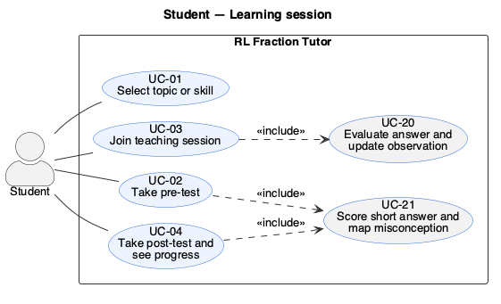

# Use cases: Student (DRAFT)

*Author: Seray · 28 Nov 2026 · Status: draft for team review. Language: English (report language).*
*Source: UC-01–UC-04 of "Beceri_Grafigi_ve_UseCase_Seray_v2" (18 Nov 2026), translated and put into the common table format. UC-20 and UC-21 are the two shared steps that were unnumbered in the earlier combined diagram.*
*Notes: In the core experiments students are represented by simulators; the student interface is a demo (FR-31, second semester). Simulators A, B and C are system components, not actors. All use cases require login (FR-37).*

## Student — learning session

**Use cases in this diagram**

- **UC-01 Select topic or skill:** the student chooses what to study.
- **UC-02 Take pre-test:** a short diagnostic test before teaching.
- **UC-03 Join teaching session:** the tutor picks questions and explanations.
- **UC-04 Take post-test and see progress:** a test after teaching, then the result.
- **UC-20 Evaluate answer and update observation:** shared step, included by UC-03.
- **UC-21 Score short answer and map misconception:** shared step, included by UC-02 and UC-04.

### UC-01 Select topic or skill

| Field | Description |
|---|---|
| Actor | Student |
| Goal | Choose the fraction topic to study (all skills or a single skill). |
| Preconditions | The student is logged in. The approved item pool has items for the chosen skill. |
| Trigger | The student opens the topic selection screen. |
| Main flow | 1. The student opens the topic selection screen. 2. The system lists the six skills in prerequisite order. 3. The student selects "all fractions" or one skill. 4. The system puts the chosen skill and its prerequisites into the session scope, saves the choice and moves on to the pre-test (UC-02). |
| Alternative flows | 3a. If the chosen skill has a prerequisite, the system keeps the prerequisite skill open automatically (for example, choosing S3 keeps S1 open) and tells the student. Actions for skills outside the scope are masked. |
| Error flows | — |
| Postconditions | The session scope (chosen skill and its prerequisites) is set. |
| Requirements | FR-05, FR-31 |

### UC-02 Take pre-test

| Field | Description |
|---|---|
| Actor | Student |
| Goal | Find out in which skills the student has difficulty before teaching starts. |
| Preconditions | UC-01 is completed. The test pool has short-answer questions for the chosen skills. |
| Trigger | The pre-test starts after UC-01. |
| Main flow | 1. The system picks 2 short-answer questions per skill in scope from the test pool (12 questions if all fractions are chosen). 2. The student types an answer to each question. 3. The system scores each answer (UC-21). 4. The system saves the pre-test result per skill and summarizes it for the student. |
| Alternative flows | 2a. If the student leaves an answer empty, it counts as wrong. |
| Error flows | 3a. If an answer cannot be parsed (for example, text), the system asks the student to enter it again. |
| Postconditions | The pre-test result is ready to be given to the tutor as part of the observation. Test questions do not teach and give no feedback. |
| Includes | UC-21 |
| Requirements | FR-06, FR-08, FR-17, FR-21 |

### UC-03 Join teaching session

| Field | Description |
|---|---|
| Actor | Student |
| Goal | Study fractions with the questions and explanations chosen by the virtual tutor. |
| Preconditions | UC-02 is completed. A trained policy (the tutor) is selected. |
| Trigger | The teaching session starts after the pre-test. |
| Main flow | 1. The tutor chooses an action from the observation (easy or hard question, hint, worked example, short lecture, misconception-specific feedback, or finish the session). 2. The system shows the approved content for that action. 3. If a question is shown, the student chooses one of four options; the system records whether it is correct and the misconception code of the chosen option (UC-20). 4. The observation is updated and steps 1–3 repeat. 5. When the tutor chooses "finish", or the step limit is reached (H = 60), the session moves to the post-test (UC-04). |
| Alternative flows | 1a. Actions for a skill whose prerequisite does not look mastered, and for skills outside the scope, are masked; the tutor cannot choose them. 1b. In the first semester the short lecture and the misconception feedback actions are masked; they open when their content is ready (the action space stays at 37). 3a. If the student leaves in the middle, the session is saved and no post-test is taken. |
| Error flows | — |
| Postconditions | Every step of the session (action, content, answer, misconception code) is recorded. |
| Includes | UC-20 |
| Requirements | FR-07, FR-19, FR-20, FR-21, FR-32, FR-33, FR-34, FR-38 |

### UC-04 Take post-test and see progress

| Field | Description |
|---|---|
| Actor | Student |
| Goal | See how much progress was made in the session. |
| Preconditions | UC-03 is completed. |
| Trigger | The teaching session ends. |
| Main flow | 1. The system gives the post-test with short-answer questions that differ from the pre-test but have the same form (2 per skill) and scores the answers (UC-21). 2. The system computes the pre-test and post-test scores and the normalized gain: g_norm = (post − pre) / (1 − pre). 3. The student sees the pre-test / post-test comparison per skill and the earlier sessions. |
| Alternative flows | 3a. If there is no earlier session, only the current result is shown. |
| Error flows | — |
| Postconditions | The session results are saved. |
| Includes | UC-21 |
| Requirements | FR-06, FR-08, FR-31, FR-38 |

### UC-20 Evaluate answer and update observation

| Field | Description |
|---|---|
| Actor | None (system function, included by UC-03) |
| Goal | Turn a student's answer into the information the tutor sees next. |
| Preconditions | A question was shown in the teaching session and the student answered. |
| Trigger | The student submits an option. |
| Main flow | 1. The system checks whether the chosen option is correct. 2. If it is wrong, the system finds the misconception code of the chosen option. 3. The system updates the observation: the counts of correct and wrong answers, the streak, the last answers, the misconception code of the last wrong answer, and the estimate of the policy-side BKT tracker. |
| Alternative flows | 2a. The wrong option has no misconception code: the system records "no misconception". |
| Error flows | — |
| Postconditions | The new observation is ready for the tutor's next decision. It contains only observable information, never the hidden student state. |
| Requirements | FR-21, FR-34, NFR-02 |

### UC-21 Score short answer and map misconception

| Field | Description |
|---|---|
| Actor | None (system function, included by UC-02 and UC-04) |
| Goal | Mark a short answer as right or wrong and link a wrong answer to a misconception when possible. |
| Preconditions | The student submitted a short answer. |
| Trigger | The student submits an answer in a test. |
| Main flow | 1. The system normalizes the answer so equal values match (for example 2/4, 1/2 and 0.5). 2. The system compares it with the correct answer and scores it right or wrong. 3. If it is wrong and equals the value of a known distractor, the system records the matching misconception code. |
| Alternative flows | — |
| Error flows | 1a. The answer cannot be parsed: the system asks the student to enter it again. |
| Postconditions | The answer has a score and, when possible, a misconception code. |
| Requirements | FR-08, FR-06 |
