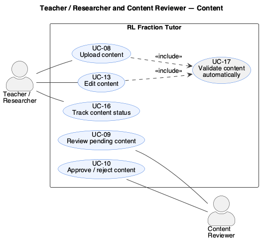
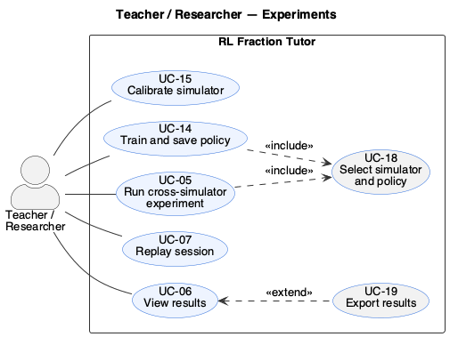

# Use cases: Teacher / Researcher and Content Reviewer (DRAFT)

*Author: Seray · 28 Nov 2026 · Status: draft for team review. Language: English (report language).*
*Actor note: the approved TÜBİTAK text defines "Teacher / Researcher" as one role, so one actor is used. Simulators, the RL agent, the BKT tracker and the Gymnasium environment are system components, not actors. All use cases require login (FR-37).*

---

## 1. Content management

**Use cases in this diagram**

- **UC-08 Upload content:** the teacher adds new items (form, JSON or CSV).
- **UC-13 Edit content:** the teacher changes an existing item or fixes a rejected one.
- **UC-16 Track content status:** the teacher sees whether an item is draft, pending, approved or rejected.
- **UC-17 Validate content automatically:** the system checks an item (included by UC-08 and UC-13).
- **UC-09 Review pending content:** the reviewer lists and inspects items waiting for approval.
- **UC-10 Approve / reject content:** the reviewer decides on an item.

### UC-08 Upload content

| Field | Description |
|---|---|
| Actor | Teacher / Researcher |
| Goal | Add new teaching items to the item bank. |
| Preconditions | The actor is logged in. |
| Trigger | The actor chooses "Upload content". |
| Main flow | 1. The actor selects the upload type (form, JSON or CSV). 2. The actor provides the items. 3. The system runs automatic validation (UC-17). 4. The system stores valid items with status *pending* (the actor may first save them as *draft*). 5. The system shows the result. |
| Alternative flows | 2a. The actor saves the upload as a draft and submits it later. |
| Error flows | 3a. Validation finds errors: the system lists them per item and stores nothing until they are fixed. |
| Postconditions | New items exist with status draft or pending. They are not yet usable by the tutor. |
| Includes | UC-17 |
| Requirements | FR-09, FR-10 |

### UC-13 Edit content

| Field | Description |
|---|---|
| Actor | Teacher / Researcher |
| Goal | Change an existing item, or correct an item the reviewer asked to change. |
| Preconditions | The actor is logged in; the item exists. |
| Trigger | The actor opens an item (from the content list, or from a reviewer's change request). |
| Main flow | 1. The actor edits the item. 2. The system runs automatic validation (UC-17). 3. The system saves the item as a new version with status *pending* (or *draft*). |
| Alternative flows | 1a. The reviewer asked for changes in UC-10: the system shows the reviewer's comment while the actor edits. |
| Error flows | 2a. Validation fails: the system shows the errors and keeps the previous version. |
| Postconditions | A new version of the item exists; earlier experiment snapshots are not changed (FR-12). |
| Includes | UC-17 |
| Requirements | FR-09, FR-10, FR-12 |

### UC-16 Track content status

| Field | Description |
|---|---|
| Actor | Teacher / Researcher |
| Goal | See which of their items are draft, pending, approved or rejected. |
| Preconditions | The actor is logged in. |
| Trigger | The actor opens the content list. |
| Main flow | 1. The system lists the actor's items with status, skill and last change. 2. The actor filters by status or skill. 3. The actor opens an item to see its history and any reviewer comment. |
| Alternative flows | 3a. The item was rejected or returned: the actor continues with UC-13. |
| Error flows | — |
| Postconditions | None (read only). |
| Requirements | FR-11 |

### UC-17 Validate content automatically

| Field | Description |
|---|---|
| Actor | None (system function, included by UC-08 and UC-13) |
| Goal | Reject malformed items before a human reviews them. |
| Preconditions | An item has been uploaded or edited. |
| Trigger | UC-08 or UC-13 reaches its validation step. |
| Main flow | 1. The system checks the required fields (skill, correct answer, question text, source and license). 2. For multiple-choice items it checks that there are four options, exactly one correct, and that every wrong option is mapped to a misconception. 3. It flags items that contain a visual (these are stored but not used in experiments). 4. It reports the result. |
| Alternative flows | 3a. Short-answer items (tests) skip the option checks and are checked for a canonical answer instead. |
| Error flows | 1a. A required field is missing: the item is marked invalid with the reason. |
| Postconditions | Each item has a validation result. |
| Requirements | FR-10, FR-07, FR-08 |

### UC-09 Review pending content

| Field | Description |
|---|---|
| Actor | Content Reviewer |
| Goal | See the items waiting for a decision and inspect them. |
| Preconditions | The reviewer is logged in. Items with status *pending* exist. |
| Trigger | The reviewer opens the review queue. |
| Main flow | 1. The system lists pending items, excluding the reviewer's own. 2. The reviewer opens an item. 3. The system shows the item, its options with misconceptions, the validation result and its version history. 4. The reviewer continues with UC-10. |
| Alternative flows | 1a. The queue is empty: the system says there is nothing to review. |
| Error flows | — |
| Postconditions | None (read only). |
| Requirements | FR-11 |

### UC-10 Approve / reject content

| Field | Description |
|---|---|
| Actor | Content Reviewer |
| Goal | Decide whether an item may enter the tutor's item pool. |
| Preconditions | The reviewer has opened a pending item (UC-09). The reviewer is not the author of the item. |
| Trigger | The reviewer chooses approve, reject or request changes. |
| Main flow | 1. The reviewer approves the item. 2. The system sets its status to *approved* and adds it to the pool available for the next snapshot. |
| Alternative flows | 1a. Reject: the reviewer gives a reason; the status becomes *rejected*. 1b. Request changes: the reviewer writes a comment; the status becomes *returned* and the author continues with UC-13. |
| Error flows | 1c. The reviewer is the author: the system blocks the decision (FR-11). |
| Postconditions | The item has a decision and a recorded reason. Only approved, visual-free items are usable by the tutor. |
| Requirements | FR-11, FR-12 |

---

## 2. Experiments

**Use cases in this diagram**

- **UC-15 Calibrate simulator:** fit the student-model parameters from data.
- **UC-14 Train and save policy:** train one tutoring policy on one simulator and store it.
- **UC-05 Run cross-simulator experiment:** evaluate saved policies and baselines on several simulators.
- **UC-18 Select simulator and policy:** shared step (included by UC-14 and UC-05).
- **UC-07 Replay session:** inspect a recorded session step by step.
- **UC-06 View results:** see the cross-simulator results.
- **UC-19 Export results:** optional export of the results (extends UC-06).

### UC-15 Calibrate simulator

| Field | Description |
|---|---|
| Actor | Teacher / Researcher (in practice the research team, with scripts) |
| Goal | Estimate the parameters of Simulator A (BKT) or B (AFM/PFA) from data. |
| Preconditions | The cleaned data set is available locally (ASSISTments; Eedi for multiple-choice guess/slip). |
| Trigger | The actor starts a calibration. |
| Main flow | 1. The actor selects the data and the model. 2. The system fits the parameters per skill. 3. The system evaluates the fit on students not used for fitting (student-level cross-validation: AUC, RMSE, log-loss). 4. The system checks that the values are plausible (guess and slip below 0.5, learning rate above 0). 5. The system saves the parameters and a report. |
| Alternative flows | 3a. The actor changes the number of restarts or the random seed and repeats. |
| Error flows | 4a. A parameter is implausible: the report flags it and the value is not used. |
| Postconditions | A parameter file and a calibration report exist. |
| Requirements | FR-02, FR-03, FR-04, FR-13, FR-14 |

### UC-14 Train and save policy

| Field | Description |
|---|---|
| Actor | Teacher / Researcher |
| Goal | Train one tutoring policy on one simulator and keep it for later evaluation. |
| Preconditions | The simulator parameters exist; an approved item-pool snapshot exists. |
| Trigger | The actor starts a training run. |
| Main flow | 1. The actor selects a simulator and a policy (UC-18). 2. The actor sets the random seeds and hyperparameters. 3. The system trains the policy (at least 10 seeds). 4. The system saves each trained policy with its configuration and the training curve. |
| Alternative flows | 1a. The actor selects a mixture of simulators or a parameter range (domain randomization). |
| Error flows | 3a. Training fails or diverges: the system keeps the log and marks the run as failed. |
| Postconditions | Saved policies exist with their configuration and seed. |
| Includes | UC-18 |
| Requirements | FR-24, FR-25, FR-27 |

### UC-05 Run cross-simulator experiment

| Field | Description |
|---|---|
| Actor | Teacher / Researcher |
| Goal | Measure how saved policies and the three baselines perform on each simulator, including simulators they were not trained on. |
| Preconditions | Saved policies exist (UC-14); an approved item-pool snapshot exists. |
| Trigger | The actor starts an experiment. |
| Main flow | 1. The actor selects the policies, baselines and test simulators (UC-18). 2. The actor selects the item-pool snapshot and the conditions (for example domain randomization or an ablation). 3. The system runs the sessions with the same student seeds for all policies. 4. The system stores the sessions and computes the normalized gain, the advantage and the transfer gap. |
| Alternative flows | 2a. The actor starts the whole experiment with one command and a configuration file. |
| Error flows | 3a. A session fails: the system records it and continues with the others. |
| Postconditions | Stored sessions and result tables exist. |
| Includes | UC-18 |
| Requirements | FR-12, FR-23, FR-25, FR-26, FR-27 |

### UC-18 Select simulator and policy

| Field | Description |
|---|---|
| Actor | None (shared step, included by UC-14 and UC-05) |
| Goal | Let the actor choose which simulator and which policy a run uses. |
| Preconditions | At least one simulator and one policy exist. |
| Trigger | UC-14 or UC-05 reaches its selection step. |
| Main flow | 1. The system lists the available simulators (A, B, C) and policies (baselines, LinUCB, MaskablePPO, saved policies). 2. The actor selects one or more. 3. The system checks that the choice is allowed (for example the LLM student is test-only). |
| Alternative flows | — |
| Error flows | 3a. The actor chooses the LLM student for training: the system refuses. |
| Postconditions | A valid simulator and policy selection. |
| Requirements | FR-13, FR-14, FR-16, FR-23, FR-24 |

### UC-07 Replay session

| Field | Description |
|---|---|
| Actor | Teacher / Researcher |
| Goal | Understand a recorded session by seeing each step. |
| Preconditions | A stored session exists. |
| Trigger | The actor selects a session. |
| Main flow | 1. The system shows the session step by step: action, answer, tracker estimate and reward. 2. The actor moves forward and backward. 3. The system also shows the hidden student state. |
| Alternative flows | 1a. The actor filters sessions by simulator, policy or student type. |
| Error flows | — |
| Postconditions | None (read only). |
| Notes | The hidden state is shown only here and in the training reward; it is never given to a policy (NFR-02). |
| Requirements | FR-28, FR-33 |

### UC-06 View results

| Field | Description |
|---|---|
| Actor | Teacher / Researcher |
| Goal | See how policies compare across simulators. |
| Preconditions | An experiment has finished (UC-05). |
| Trigger | The actor opens the results. |
| Main flow | 1. The system shows the cross-simulator table: advantage and transfer gap for each policy and simulator, with 95% confidence intervals and the worst case. 2. The system shows the number of sessions per cell. 3. The actor compares conditions. |
| Alternative flows | 3a. The actor opens the action-distribution and reward-hacking report. |
| Error flows | 1a. Some cells are missing: the system marks them as not run. |
| Postconditions | None (read only). |
| Extended by | UC-19 |
| Requirements | FR-26, FR-29, FR-36, FR-39 |

### UC-19 Export results

| Field | Description |
|---|---|
| Actor | Teacher / Researcher |
| Goal | Take the results out of the system for the report. |
| Preconditions | The actor is viewing results (UC-06). |
| Trigger | The actor chooses "Export". |
| Main flow | 1. The actor selects what to export (table, figures) and the format (CSV or image). 2. The system writes the files. |
| Alternative flows | — |
| Error flows | 2a. The export cannot be written: the system shows an error. |
| Postconditions | The exported files exist. |
| Extends | UC-06 |
| Requirements | FR-29 |
